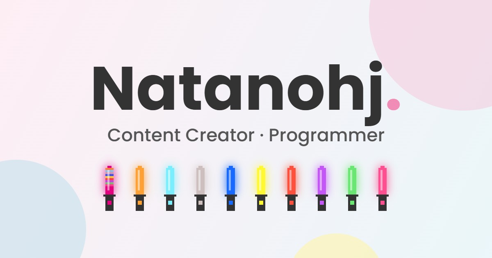

<div align="center">



# Natanohj

[](https://github.com/Natanmiuz/p-toforio/actions/workflows/deploy.yml)
[](https://astro.build)


Sitio personal de **Natanohj**, creador de contenido y programador.
Una sola página, estática y en tres idiomas.

[**Ver el sitio**](https://natanmiuz.github.io/p-toforio/) · [Funciones](#funciones) · [Empezar](#empezar) · [Cómo cambiar cosas](#cómo-cambiar-cosas)

</div>

## Funciones

- **Tres idiomas generados en el build**: inglés en `/`, español en `/es/` y japonés en `/ja/`. Cada versión es HTML estático con su propio `lang`, canonical y `hreflang`.
- **Selector de oshi**: diez penlights de μ's en el hero. Al elegir una integrante, toda la página toma su color (con `:has()`, sin JavaScript). La elección se recuerda en el navegador.
- **Último video del canal**: en cada build se lee el feed RSS público de YouTube (sin API key ni Shorts). La portada carga el reproductor solo al hacer clic.
- **Modo oscuro** persistente y sin destello blanco al cargar.
- **SEO**: sitemap con alternativas por idioma, Open Graph con imagen, JSON-LD `Person` y etiquetas accesibles traducidas.

## Empezar

Necesitas [Node.js](https://nodejs.org) 22.12 o superior.

```bash
npm install
npm run dev
```

Abre <http://localhost:4321/p-toforio/>.

> [!NOTE]
> Todas las rutas cuelgan de `/p-toforio/` porque GitHub Pages sirve el sitio en ese subdirectorio (`base` en `astro.config.mjs`). La raíz `http://localhost:4321/` no muestra nada.

| Comando | Qué hace |
| --- | --- |
| `npm run dev` | Servidor de desarrollo con recarga en vivo. |
| `npm run check` | Valida las traducciones: mismas keys en los tres idiomas y ningún valor vacío. |
| `npm run build` | `check` + `astro check` (tipos) + build estático en `dist/`. |
| `npm run preview` | Sirve `dist/` para revisar el build. |

> [!IMPORTANT]
> El build falla si una traducción está incompleta o hay un error de tipos. Así ningún error de ese tipo llega a publicarse.

## Estructura

```text
src/
├── pages/[...locale].astro   # Una sola ruta que genera /, /es/ y /ja/
├── layouts/Layout.astro      # <head>: SEO, Open Graph, hreflang, JSON-LD
├── components/               # Header, Hero, ContentCreator, Programmer, Contact, Footer
├── data/
│   ├── social.ts             # Redes sociales (tarjetas, footer, DM y JSON-LD)
│   └── projects.ts           # Proyectos de la sección de programador
├── i18n/
│   ├── locales.json          # Lista de idiomas: la leen Astro, las páginas y check-i18n
│   ├── index.ts              # Carga las traducciones y exporta los tipos
│   └── lang/{en,es,ja}.json  # Textos, con keys planas como "nav.home"
├── lib/youtube.ts            # Lee el último video del feed RSS en el build
├── scripts/                  # JS del navegador: nav, tema, oshi y AOS
└── styles/                   # style.css (variables y oshi) y dark-mode.css
```

Los componentes reciben las traducciones como prop `t` y las pintan en el servidor (`{t['nav.home']}`). En el navegador no se traduce nada.

## Cómo cambiar cosas

**Un texto.** Edita la misma key en `src/i18n/lang/en.json`, `es.json` y `ja.json`. Si una key falta en alguno, `npm run check` lo indica.

**Una red social.** Edita `src/data/social.ts`. Una red sin `url` se muestra deshabilitada. Los cambios llegan a las tarjetas, al footer y al JSON-LD a la vez.

**Un proyecto.** Añádelo en `src/data/projects.ts` con su `descKey` y crea esa key en los tres JSON de idioma.

**Un idioma.** Añade una entrada en `src/i18n/locales.json` (`code`, nombre nativo y locale de Open Graph) y su archivo `src/i18n/lang/<code>.json` con todas las keys. La ruta, el selector, el `hreflang` y el sitemap se generan solos.

> [!TIP]
> El formulario de contacto todavía no envía nada: el botón muestra un aviso traducido (`form.comingSoon`). Para conectarlo, el punto de partida es `src/components/Contact.astro`.

## Deploy

Cada push a `main` ejecuta [`.github/workflows/deploy.yml`](.github/workflows/deploy.yml), que hace `npm ci` y `npm run build` y publica `dist/` en GitHub Pages.

> [!TIP]
> El último video se lee al compilar, así que un video nuevo aparece en el próximo deploy. Para actualizarlo sin cambiar código, ejecuta el workflow a mano desde **Actions → Deploy to GitHub Pages → Run workflow**.

Para publicar con un dominio propio, cambia `site` y `base` en `astro.config.mjs`. Las URLs del `<head>` se derivan de esos dos valores.

## Tecnologías

[Astro 7](https://astro.build) con [`@astrojs/sitemap`](https://docs.astro.build/en/guides/integrations-guide/sitemap/) y `astro check`, CSS propio y JavaScript sin frameworks. Desde CDN se cargan [Poppins](https://fonts.google.com/specimen/Poppins), [Font Awesome 6](https://fontawesome.com) y [AOS](https://michalsnik.github.io/aos/) para las animaciones al hacer scroll.
